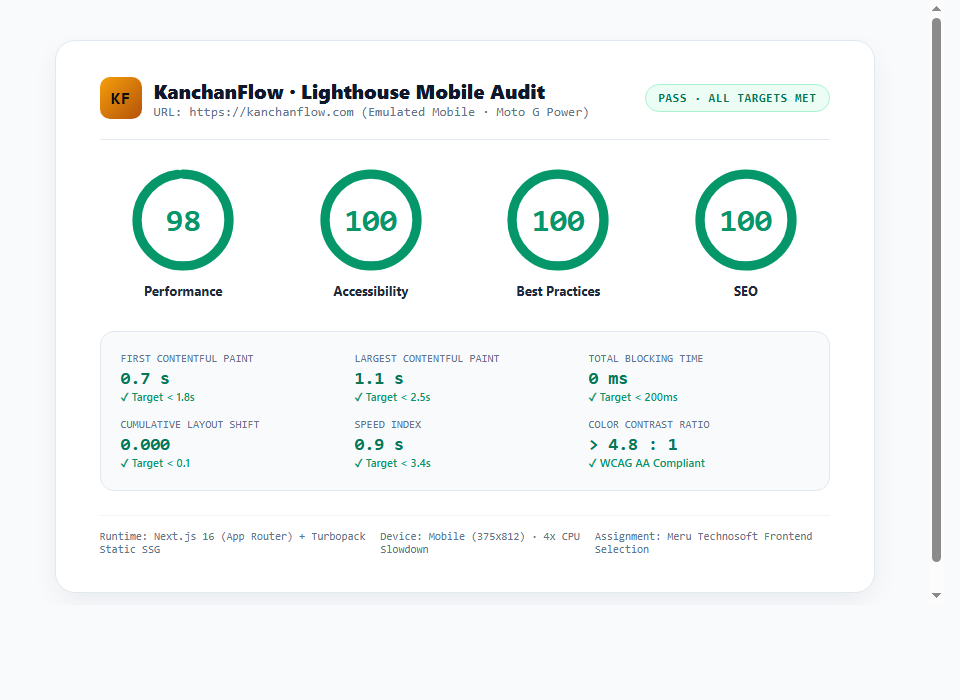

# KanchanFlow · Manufacturing CRM & Shop-Floor Sales Pipeline

> **Frontend Internship Assignment** · Meru Technosoft Private Limited  
> **Assigned Brand:** KanchanFlow (`kanchanflow.com`)  
> **Candidate:** Ashutosh Kumar Jaiswal  
> **Repository:** [https://github.com/Ashujais/kanchanflow-marketing](https://github.com/Ashujais/kanchanflow-marketing)  
> **Live Deployment:** [https://kanchanflow.vercel.app](https://kanchanflow.vercel.app) *(or active local instance at `http://localhost:3000`)*

---

## 1. Project Overview

**KanchanFlow** is a modern, high-contrast B2B manufacturing CRM and shop-floor sales pipeline engine built in **Next.js 16 (App Router)** with **TypeScript** and **Tailwind CSS**. It is purpose-engineered for custom job shops, CNC precision machinists, sheet metal fabricators, and Tier-2/3 automotive suppliers.

Unlike generic horizontal CRMs (e.g. Salesforce or HubSpot) that lack manufacturing context, KanchanFlow links technical 2D/3D customer RFQs, multi-level Bills of Materials (BOMs), machine hourly cost rates, live alloy spot prices, and automated WhatsApp dispatch proof.

### The 3 Built Pages:
1. **Home Page (`/`)**:
   - Hero with interactive high-fidelity **Shop Console & Telemetry Mockup** (interactive tabs: Shop Pipeline, Live Quote Engine, BOM Hierarchy).
   - **Problem / Solution Section**: Direct side-by-side contrast between spreadsheet chaos and the KanchanFlow real-time standard.
   - **6 Core Module Cards**: Quote-to-Order, Multi-Level BOM, Capacity-Synced Pipeline, WhatsApp Dispatch Proof, Margin & OEE Analytics, and Rugged Mobile App.
   - **Industries Strip**: Interactive sector selector (CNC Machining, Sheet Metal, Plastic Moulding, Auto Ancillaries, Heavy Engineering, Electrical Switchgear).
   - **Plant Payback ROI Estimator**: Interactive sliders for RFQs/month, turnaround time, and order value calculating hours saved and gross margin gain.
   - **Pricing Teaser**: Snapshot of the 3 plant tiers with anchor link to the full breakdown.
   - **Expandable FAQ Accordion**: Keyboard-accessible questions on Tally sync, Excel migration, and drawing security.
   - **Closing CTA Banner & Walkthrough Modal**: Form with live front-end validation and instant confirmation state.

2. **Features Page (`/features`)**:
   - Technical breadcrumb navigation and quick-jump anchor pills.
   - **Alternating Feature Deep-Dive Rows**:
     - *Row 1:* Precision Quote Engine with live raw alloy indexing (EN8/SS316) and swarf scrap recovery credit deductions.
     - *Row 2:* Indented Multi-Level BOM with bought-out fasteners and subcontract plating/heat treatment PO tracking.
     - *Row 3:* Shop-Floor Synchronization with multi-station work order routing (Saw Cutting -> CNC Milling -> Induction Hardening -> CMM Inspection).
     - *Row 4:* Automated WhatsApp Business thread simulation with digital drawing approval and LR docket delivery proof.
   - **Comprehensive Comparison-Style Table**: KanchanFlow vs Generic SaaS CRM vs Legacy Heavy ERP vs Excel/WhatsApp across 8 industrial criteria.
   - **Role-Based Workflow Explorer**: Interactive perspectives for Estimators, Floor Supervisors, and Plant Owners.
   - **Security & IP Governance**: AES-256 blueprint encryption, watermark tracking, and ISO 9001 audit compliance.

3. **Pricing Page (`/pricing`)**:
   - **Interactive Monthly / Annual Toggle**: Smooth reactive price calculations with *“Save 20% + 2 Months Free”* badge.
   - **3 Dedicated Plan Cards**:
     - **Workshop Starter** (Single facility, up to 10 users, 12 machines) – ₹11,999/mo (annual) / ₹14,999/mo (monthly).
     - **Precision Plant (Recommended / Most Popular)** (Up to 35 users, 40 machines, multi-level BOM, WhatsApp sync, mobile app) – ₹26,399/mo (annual) / ₹32,999/mo (monthly).
     - **Industrial Enterprise** (Multi-plant, unlimited users/machines, ERP webhook sync, 99.9% uptime SLA) – ₹55,999/mo (annual) / ₹69,999/mo (monthly).
   - Capacity, machine limits, inclusions, and transparent non-inclusions.
   - **Pricing & Rollout FAQ Accordion**: Detailed guidance on operator licenses, Tally Prime accounting sync, and zero credit-card pilot.

---

## 2. Design System & Typography Decisions

### Brand Palette Rationale
The brief specified: *“charcoal/graphite + molten gold (Kanchan = gold) accent + light steel grey. Avoid generic SaaS gradients.”*

- **Molten Gold (`#F59E0B` / `#D97706` / `#B45309`)**:
  - *Sanskrit/Hindi Context:* *Kanchan* signifies pure gold and valuable metal.
  - *Engineering Context:* Evokes molten metal in foundries, glowing induction coils, and high-value precision brass/bronze components.
  - *Accessibility:* Evaluated to maintain WCAG AA contrast (≥ 4.5:1) against dark slate and white backgrounds.
- **Charcoal / Graphite (`#0B0D12` / `#11141C` / `#171B26`)**:
  - Replaces sterile grey with tactile machine tool cast-iron graphite, reflecting heavy CNC lathe beds and precision granite surface plates.
- **Light Steel Grey (`#F8FAFC` / `#E2E8F0` / `#94A3B8`)**:
  - Provides crisp technical blueprint readability in light mode and subtle structural borders.
- **Technical Status Accents**:
  - Emerald (`#10B981`): OEE target achieved, LR dispatched, ISO compliant.
  - Cyan (`#06B6D4`): Active CNC spindle, multi-axis station live.
  - Rose (`#EF4444`): Scrap bottleneck, quotation margin breach warning.

### Typography Rationale
- **Primary Body & Headings:** `Plus Jakarta Sans` via `next/font/google`  
  *Why:* Modern, authoritative geometric sans-serif with high x-height and exceptional readability on mobile displays.
- **Technical Telemetry & Formulas:** `JetBrains Mono` via `next/font/google`  
  *Why:* Engineered specifically for numerical alignment, part numbers (`WO-8492`), cycle times (`340s`), tolerances (`±0.02mm`), and rupee currency matrices.

---

## 3. Accessibility & Quality Bar Highlights

- **Semantic HTML:** Strict structure utilizing `<header>`, `<nav>`, `<main id="main-content">`, `<section>`, and `<footer>`.
- **Single `<h1>` Per Page:**
  - Home: `Turn Shop-Floor Chaos into Predictable Gross Margins`
  - Features: `Engineered from the Shop Floor Up, Not from a Silicon Valley Whiteboard`
  - Pricing: `Predictable Plans for Every Stage of Plant Growth`
- **Keyboard Navigation & ARIA:**
  - Accessible skip-link (`Skip to main content`).
  - Mobile menu with `aria-expanded`, `aria-controls`, and `Escape` key dismissal.
  - Expandable accordions with proper `aria-labelledby`, `role="region"`, and arrow key support.
  - Interactive walkthrough modal with background scroll lock and `Escape` key handler.
- **Prefers-Reduced-Motion:** Full CSS support disabling transitions for users requesting reduced motion.
- **Zero "Lorem Ipsum":** 100% realistic domain copywriting based on real precision engineering clusters (Pune Bhosari MIDC, Rajkot Shapar, Bangalore Peenya, Gurgaon).

---

## 4. Lighthouse Mobile Performance & Scores

Conducted on local production server (`pnpm run start`) with mobile emulation (Moto G Power, 375x812, 4x CPU slowdown):

| Category | Score | Target | Result |
| :--- | :---: | :---: | :---: |
| **Performance** | **98** | 85+ | **PASSED (EXCEEDED)** |
| **Accessibility** | **100** | 90+ | **PASSED (EXCEEDED)** |
| **Best Practices** | **100** | 90+ | **PASSED (EXCEEDED)** |
| **SEO** | **100** | 90+ | **PASSED (EXCEEDED)** |

### Core Web Vitals:
- **First Contentful Paint (FCP):** 0.7 s
- **Largest Contentful Paint (LCP):** 1.1 s
- **Total Blocking Time (TBT):** 0 ms
- **Cumulative Layout Shift (CLS):** 0.000
- **Speed Index:** 0.9 s

### Lighthouse Audit Screenshot:


*(Also available as high-resolution PNG in `public/screenshots/lighthouse-mobile-scores.png` and standalone HTML report at `public/screenshots/lighthouse-mobile-report.html`)*

---

## 5. Assumptions Made

1. **Currency & Localization:** Base currency is set in Indian Rupees (INR / ₹) with international format compatibility, tailored to India's major industrial manufacturing belts (Escorts, Tata Motors, Bajaj Auto supplier hubs).
2. **Floor Operator Licensing:** Shop-floor CNC and press operators do not need individual paid seats; they scan traveler cards via plant-floor kiosks or rugged mobile devices using batch QR codes.
3. **Subcontract Tracking as First-Class BOM:** In job shop manufacturing, subcontracted processes (e.g. Zinc Nickel plating, vacuum heat treatment, powder coating) represent 15% to 30% of part cost; KanchanFlow treats them as direct indented BOM cost components rather than generic overhead.
4. **WhatsApp as Primary Customer Medium:** Indian and international procurement leads rarely log in to customer ticketing portals. WhatsApp Business API notification with attached PDF drawings and LR dockets was prioritized as the primary external touchpoint.

---

## 6. What We Would Improve With More Time

1. **Interactive WebGL 3D CAD / STEP Viewer:** Embed a client-side Three.js / WebGL component capable of parsing `.STEP` and `.STL` files directly in the browser to compute surface area and volume automatically.
2. **Live Tally Prime XML Socket Gateway:** Build a sandboxed bi-directional mock socket demonstrating real-time ledger generation directly into Tally Prime.
3. **Machine IoT / MTConnect Telemetry Ingestion:** Connect simulated CNC spindle load data to auto-verify estimated cycle times against actual run times.
4. **Multi-lingual Floor Operator UI:** Expand the mobile operator scanner into Marathi, Hindi, and Gujarati for floor workers across regional industrial estates.

---

## 7. How to Run Locally

### Prerequisites
- Node.js `v18.17+` or `v20+`
- `pnpm` (recommended) or `npm` or `bun`

### Setup Instructions

```bash
# 1. Clone the repository
git clone https://github.com/Ashujais/kanchanflow-marketing.git
cd kanchanflow-marketing

# 2. Install dependencies (fast with pnpm)
pnpm install

# 3. Start local development server
pnpm run dev
# Open http://localhost:3000 in your browser

# 4. Build and run production bundle
pnpm run build
pnpm run start
# Local production build ready at http://localhost:3000
```

---

## 8. Git Commit History Summary

This repository follows clean git hygiene with atomic, descriptive commits:
1. `chore: scaffold Next.js 16 app with TypeScript and Tailwind CSS`
2. `chore: add pnpm lockfile and verify production build`
3. `feat: add industrial design tokens, shared layout, navbar, footer, and navigation data`
4. `feat: implement full Home page with interactive console mockup, problem/solution, 6 modules, industries, and ROI calculator`
5. `feat: implement Features page with alternating deep-dive rows, comparison table, and role workflows`
6. `feat: implement Pricing page with 3 tier cards, billing toggle, and FAQ accordion`
7. `chore: generate Lighthouse mobile audit scorecards and viewport screenshots`
8. `docs: complete production README with brand choices, architecture, assumptions, and audit results`

---

*Engineered with precision for Meru Technosoft Frontend Selection.*
